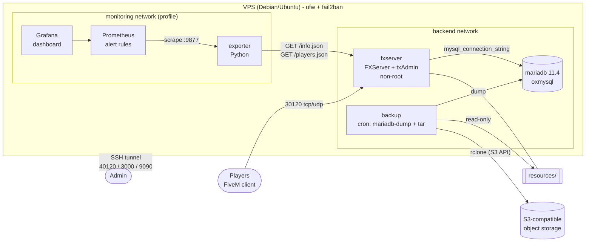

# fivem-server-ops

Deployment and operations tooling for a **FiveM (GTA V multiplayer) game server**:
containerized FXServer, MariaDB, automated off-site backups, Prometheus/Grafana
monitoring, host provisioning with Ansible and CI on GitHub Actions.

It comes from running community FiveM servers, where the usual setup is "a
Windows VPS, a zip of resources and a prayer". This repo is the setup I wish I
had: reproducible, observable and restorable.

> FXServer and txAdmin are **not** included. The Cfx.re artifacts are
> downloaded from the official artifact server at image build time, pinned by
> build number, in line with the Cfx.re terms. You need your own license key
> from [portal.cfx.re](https://portal.cfx.re).

## Contents

- [Architecture](#architecture)
- [Why containerize a game server?](#why-containerize-a-game-server)
- [Repository layout](#repository-layout)
- [Quick start](#quick-start)
- [Configuration](#configuration)
- [Backups](#backups)
- [Monitoring](#monitoring)
- [Provisioning a VPS](#provisioning-a-vps)
- [CI/CD](#cicd)
- [Ops runbook](#ops-runbook)
- [Security notes](#security-notes)
- [Roadmap](#roadmap)

## Architecture



| Service      | Image                         | Exposed                         |
|--------------|-------------------------------|---------------------------------|
| `fxserver`   | built from `docker/`          | `30120/tcp+udp` public, `40120` localhost |
| `mariadb`    | `mariadb:11.4`                | internal only                   |
| `backup`     | built from `backup/`          | none                            |
| `exporter`   | built from `monitoring/exporter/` | internal only               |
| `prometheus` | `prom/prometheus:v2.54.1`     | `127.0.0.1:9090`                |
| `grafana`    | `grafana/grafana:11.2.2`      | `127.0.0.1:3000`                |

## Why containerize a game server?

A game server is a long-lived, stateful process, which is exactly why it is
usually managed by hand. Containerizing it fixes the problems I kept hitting:

- **Pinned, reproducible artifacts.** The FXServer build is a build argument.
  "Update to the latest artifact" becomes a reviewed one-line change that can
  be rolled back by redeploying the previous image tag, instead of
  overwriting files in place on a live box.
- **State is explicit.** Everything that matters lives in named volumes or the
  `resources/` bind mount: database, txAdmin data, resources. The container
  itself is disposable, which makes backups and migrations easy to reason about.
- **Same stack everywhere.** A developer can run the exact server + database
  locally with `docker compose up`, which kills "works on the live server only".
- **Process supervision for free.** `restart: unless-stopped`, healthchecks and
  `tini` as PID 1 (clean shutdown on `SIGTERM`) replace screen/tmux sessions.
- **Isolation.** FXServer runs as an unprivileged user, the database is never
  published to the internet, and backups only get read-only access to resources.

Trade-offs worth knowing: UDP through Docker's NAT adds a little overhead
(negligible at FiveM's packet rates, `network_mode: host` is an option if
needed), and Docker-published ports bypass UFW (handled, see
[Security notes](#security-notes)).

## Repository layout

```
.
├── docker/                    # FXServer image
│   ├── Dockerfile             # multi-stage, artifacts fetched at build time
│   ├── entrypoint.sh          # renders server.cfg, standalone or txAdmin mode
│   └── healthcheck.sh         # /info.json probe (or txAdmin panel)
├── server-data/
│   ├── server.cfg.template    # envsubst template, no secrets
│   └── resources/             # your resources (git-ignored)
├── backup/                    # backup sidecar image
│   ├── backup.sh              # mariadb-dump + tar + checksums + rclone + rotation
│   ├── restore.sh             # verified restore from local or remote
│   └── entrypoint.sh          # cron scheduling
├── monitoring/
│   ├── exporter/              # Python Prometheus exporter + pytest suite
│   ├── prometheus/            # scrape config, alert rules, rule unit tests
│   └── grafana/               # provisioning + dashboard JSON
├── ansible/                   # VPS provisioning (docker, ufw, fail2ban, sshd)
├── .github/workflows/         # lint, tests, image builds
├── docker-compose.yml
├── .env.example
└── Makefile
```

## Quick start

Prerequisites: Docker Engine 24+ with the compose plugin, a Cfx.re license key.

```bash
git clone <this repo> && cd fivem-server-ops
cp .env.example .env
$EDITOR .env        # ARTIFACT_BUILD, FIVEM_LICENSE_KEY, passwords

# Base resources (mapmanager, chat, spawnmanager, ...)
git clone --depth 1 https://github.com/citizenfx/cfx-server-data /tmp/cfx
cp -r /tmp/cfx/resources/* server-data/resources/

docker compose up -d --build
docker compose ps                       # wait for fxserver to be "healthy"
docker compose logs -f fxserver
```

Picking `ARTIFACT_BUILD`: open the
[Linux artifacts list](https://runtime.fivem.net/artifacts/fivem/build_proot_linux/master/)
and copy a folder name (`NNNNN-<commit sha>`), ideally one marked as recommended.
Set `ARTIFACT_SHA256` to the checksum of its `fx.tar.xz` so the build fails if
the download is not what you validated.

With monitoring:

```bash
docker compose --profile monitoring up -d --build
ssh -L 3000:127.0.0.1:3000 -L 9090:127.0.0.1:9090 user@your-vps
# Grafana: http://localhost:3000 (admin / GRAFANA_ADMIN_PASSWORD)
```

## Configuration

All configuration comes from `.env` (see `.env.example`, every variable is
commented). At start, `docker/entrypoint.sh` renders
`server-data/server.cfg.template` with `envsubst`, substituting **only a
whitelisted list of variables**, and writes it with `0600` permissions inside
the container. The rendered file never touches the repository.

The entrypoint refuses to start if the license key is missing or still the
placeholder: failing loudly beats a server that boots and silently refuses players.

### Standalone vs txAdmin mode

| | `TXADMIN_ENABLED=false` (default) | `TXADMIN_ENABLED=true` |
|---|---|---|
| Who starts FXServer | the entrypoint, `+exec server.cfg` | txAdmin |
| server.cfg | rendered from the template | managed in txAdmin |
| Restarts / schedules | Docker restart policy | txAdmin scheduler |
| Healthcheck | `GET :30120/info.json` | txAdmin panel responds |

Standalone mode keeps the whole config in git (GitOps-friendly); txAdmin mode is
what most server owners are used to. Both are supported. txAdmin settings live
in the `txdata` volume, which is part of what you should back up if you use it.

### txAdmin access

The panel is bound to `127.0.0.1:40120` by default. Recommended access is an
SSH tunnel:

```bash
ssh -L 40120:127.0.0.1:40120 user@your-vps   # then open http://localhost:40120
```

If staff need direct access, set `TXADMIN_BIND=0.0.0.0` **and** list their IPs
in `txadmin_allowed_cidrs` (Ansible), which filters the port in both UFW and
Docker's `DOCKER-USER` chain.

## Backups

The `backup` container runs `backup/backup.sh` on `BACKUP_SCHEDULE` (default
every 6 hours). Each run produces:

```
/backups/fivem-20261126T060000Z/
├── db.sql.gz          # mariadb-dump --single-transaction (no table locks, server keeps running)
├── resources.tar.gz   # resources/ (cache and node_modules excluded)
├── manifest.txt
└── SHA256SUMS
```

Then it:

1. uploads the folder with `rclone copy --checksum` to `BACKUP_REMOTE`
   (any S3-compatible storage: AWS S3, Backblaze B2, Cloudflare R2, Wasabi,
   MinIO, Scaleway...) and runs `rclone check` to verify the upload;
2. deletes remote backups older than `BACKUP_KEEP_REMOTE_DAYS`;
3. keeps the `BACKUP_KEEP_LOCAL` most recent local copies;
4. optionally pings `BACKUP_PING_URL` (success or `/fail`), so a backup that
   *stops running* also raises an alert (dead man's switch).

Design choices:

- **Credentials never on the command line**: the DB password goes through a
  temporary `0600` defaults file, so it does not show up in `ps`.
- **No half-written backups**: work happens in `.inprogress-*`, renamed only on
  success; a trap removes it on failure.
- **No overlapping runs**: `flock` on a lock file.
- **rclone is configured with environment variables** (`RCLONE_CONFIG_S3BACKUP_*`),
  so there is no `rclone.conf` to manage. Use an access key scoped to the
  backup bucket only, ideally with object lock / versioning enabled on the bucket.
- The license key is not passed to the backup container: it only receives the
  variables it needs.

Manual operations:

```bash
make backup                                          # backup now
docker compose --profile restore run --rm restore --list
docker compose --profile restore run --rm restore --list --remote
```

### Restore

`restore.sh` verifies `SHA256SUMS` before touching anything, asks for
confirmation (type `restore`, or pass `--yes`), restores the database and moves
the current `resources/` aside (`resources.pre-restore-<timestamp>`) instead of
deleting it.

```bash
docker compose stop fxserver
docker compose --profile restore run --rm restore fivem-20261126T060000Z
# or: restore --remote latest          (download from object storage first)
# or: restore --db-only latest / restore --resources-only latest
docker compose start fxserver
```

A backup you have never restored is a hope, not a backup: test the procedure
on a staging machine regularly (see roadmap).

## Monitoring

### Exporter

`monitoring/exporter/fivem_exporter.py` is a small Prometheus exporter
(`prometheus_client`, standard library HTTP) that queries FXServer's public
endpoints **on every scrape** (no background polling, no stale data):

| Metric | Description |
|---|---|
| `fivem_up` | 1 if `/info.json` and `/players.json` answered with valid JSON |
| `fivem_players_online` | number of connected players |
| `fivem_players_max` | `sv_maxClients` |
| `fivem_player_ping_avg_ms` | average player ping |
| `fivem_resources` | resources reported by the server |
| `fivem_http_response_seconds{endpoint}` | endpoint latency (server thread health) |
| `fivem_server_info{version}` | FXServer build |
| `fivem_scrape_errors_total` | failed scrapes since start |

It runs as a non-root user in a slim image, and is covered by a pytest suite
(canned payloads, failures, timeouts, malformed JSON, plus an end-to-end test
against a local fake FXServer HTTP server).

The server config sets `sv_exposePlayerIdentifiersInHttpEndpoint false`: the
exporter only needs to count players, it never needs their identifiers.

### Alerts

`monitoring/prometheus/alerts.yml`, unit-tested with `promtool test rules`
(`alerts_test.yml`):

| Alert | Condition | Severity |
|---|---|---|
| `FiveMServerDown` | `fivem_up == 0` for 2m | critical |
| `FiveMExporterDown` | exporter target down for 2m | warning |
| `FiveMPlayerCountDrop` | players < 50% of the 15 min peak (peak ≥ 10) for 3m, server still up | warning |
| `FiveMSlowResponses` | endpoint latency > 1s for 5m | warning |
| `FiveMServerFull` | all slots used for 10m | info |
| `FiveMHighPlayerPing` | average ping > 150 ms for 10m | info |

The player-drop alert is the interesting one: a server can be "up" while every
player has just been kicked by a crashing resource. The `peak >= 10` guard
avoids paging at 4am because 3 players out of 5 logged off.

### Dashboard

`monitoring/grafana/dashboards/fivem-overview.json` is provisioned
automatically: status, players online / slots used, average ping, players over
time, endpoint latency, availability and 24h uptime, with a `server` variable
for multi-server setups.

## Provisioning a VPS

`ansible/` turns a fresh Debian 12 or Ubuntu 22.04/24.04 VPS into a host ready
for the stack:

- **base**: packages, unattended security upgrades, timezone, deploy user
  (uid 1000, matching the container user), SSH keys, sshd hardening (no root
  login, no password auth), file descriptor limits, UDP buffer sysctls;
- **docker**: Docker Engine + compose plugin from Docker's official repo,
  log rotation and `live-restore` in `daemon.json`;
- **firewall**: UFW default deny, SSH rate limited, `30120/tcp+udp` open,
  `40120` only from `txadmin_allowed_cidrs`, plus a systemd unit maintaining
  `DOCKER-USER` rules for txAdmin;
- **fail2ban**: `sshd` jail (systemd backend, aggressive mode) and `recidive`
  for repeat offenders, banning through UFW;
- **app**: syncs this repo to `/opt/fivem-server-ops` (secrets excluded).

```bash
cd ansible
cp inventory.example.ini inventory.ini        # set your host
$EDITOR group_vars/all/main.yml               # SSH keys, admin CIDRs
ansible-galaxy collection install -r requirements.yml
ansible-playbook site.yml --check --diff      # dry run first
ansible-playbook site.yml
```

Make sure your SSH key is in `deploy_ssh_public_keys` (or already authorized for
your user) before running it with `ssh_disable_password_auth: true`.

## CI/CD

| Workflow | What it does |
|---|---|
| `lint.yml` | shellcheck, hadolint (3 Dockerfiles), yamllint, `promtool check/test rules`, `docker compose config`, gitleaks secret scan |
| `exporter-tests.yml` | pytest on Python 3.12 |
| `images.yml` | builds the three images with Buildx + GHA cache; pushes `exporter` and `backup` to GHCR on `main` and `v*` tags |

The FXServer image is **built but not pushed** by default: publishing it would
redistribute Cfx.re binaries. Set the repository variable
`FXSERVER_ARTIFACT_BUILD` to enable the build, and `FXSERVER_PUSH=true` only if
the GHCR package is private.

## Ops runbook

### Update FXServer artifacts

1. Pick the new build on the artifacts page; read the changelog / Cfx.re
   announcements for breaking changes (game build, OneSync, natives).
2. Back up first: `make backup`.
3. Note the current image for rollback:
   `docker compose images fxserver` (or keep the old tag, see below).
4. Update `ARTIFACT_BUILD` (and `ARTIFACT_SHA256`) in `.env`, ideally tagging
   the image with the build: `FXSERVER_IMAGE=fivem-server-ops/fxserver:<build>`.
5. `docker compose build fxserver && docker compose up -d fxserver`
6. Verify: `docker compose ps` shows `healthy`, `docker compose logs fxserver`
   has no resource errors, Grafana shows players reconnecting, connect yourself.
7. Announce the restart to players beforehand (txAdmin scheduled restart or
   in-game message): the update needs a server restart.

### Rollback

Because images are tagged per artifact build, rollback is a redeploy:

```bash
# .env: FXSERVER_IMAGE=fivem-server-ops/fxserver:<previous build>
docker compose up -d fxserver
```

If the new version already migrated the database (framework update), restore
the backup taken in step 2: `make restore-latest` (or `restore <name>`).

For resource changes, roll back with git in your resources repository and
`restart <resource>` in the console (or restart the container).

### Restore a backup

See [Restore](#restore). Checklist: stop `fxserver`, restore, start, check logs,
check a player's data in-game, keep `resources.pre-restore-*` until you are sure.

### Server down alert

1. `docker compose ps`: is the container restarting (crash loop) or unhealthy?
2. `docker compose logs --tail=300 fxserver`: last resource started before the
   crash is usually the culprit.
3. `docker compose ps mariadb`: oxmysql errors often mean the database is down
   or out of connections.
4. Host: `df -h` (full disk from logs or backups), `free -m`, `dmesg | tail`
   (OOM killer).
5. Stabilize first (stop the faulty resource, roll back), investigate after.

### Player count drop alert

Check the console for a resource error or a mass "timed out" disconnect, look at
the latency panel (server hitch), then at host network (DDoS protection
dashboards of your provider).

## Security notes

- **Docker bypasses UFW.** Published ports are DNAT'ed in Docker's own iptables
  chains, before UFW rules apply. Admin ports are therefore bound to
  `127.0.0.1` in compose, and Ansible adds `DOCKER-USER` rules as a second layer.
- Secrets live only in `.env` (git-ignored, `chmod 600` it). The license key is
  injected at runtime, never baked into an image or committed.
- MariaDB has no published port; the backup container gets resources read-only.
- FXServer and the exporter run as non-root users.
- gitleaks runs in CI to catch committed secrets.

## Roadmap

- [ ] Alertmanager with Discord webhook notifications
- [ ] Automated weekly restore test into a throwaway stack (backup verification)
- [ ] restic as an alternative backend (deduplication, encryption at rest)
- [ ] Encrypt backups client-side (rclone `crypt` remote)
- [ ] Node exporter + cAdvisor for host and container metrics
- [ ] Loki/Promtail for centralized FXServer logs
- [ ] IPv6 `DOCKER-USER` (ip6tables) rules
- [ ] Multi-server support (one compose project per server, shared monitoring)
- [ ] Renovate to propose base image and artifact updates

## License

[MIT](LICENSE) for the tooling in this repository. FXServer, txAdmin and other
Cfx.re software are subject to their own terms.
